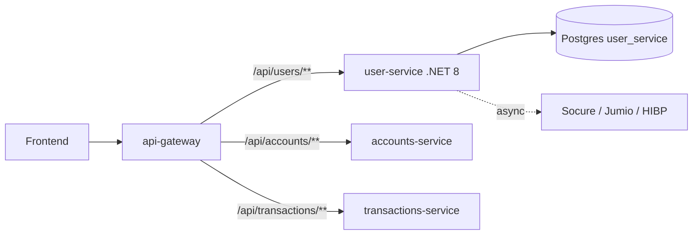

# Design — Authentication & User Management

`user-service` owns users and mints JWTs. `api-gateway` enforces a token on every
non-public route. Each downstream service re-validates the token with the shared
`JWT_SECRET`, so it is safe even if reached directly inside the cluster.

## Components

- **user-service:** `UsersController` (register, login, profile, check-*), `UserService`
  (register, authenticate, token generate/validate), `IdentityVerificationService`
  (fire-and-forget, 5s timeouts), EF Core/Npgsql persistence. `Program.cs` idempotently
  creates `user_service.users` and seeds demo data. There is no global auth middleware;
  `/profile` validates the token itself (AGENTS.md exempts user-service).
- **api-gateway:** `GatewayConfig` (routes, Redis rate limiter on accounts and
  transactions), `RouterValidator` (public allow list), `AuthenticationFilter` +
  `JwtUtil` (reject missing/invalid/expired tokens).
- **frontend:** `lib/auth/token.ts` (`TokenManager` over `js-cookie`: set/get/remove,
  decode, expiry) and `lib/api/{client,auth}.ts` (axios interceptors add the header).

## JWT contract

HMAC-SHA256, secret from `JWT_SECRET`, claims `sub`/`userId`/`roles`, 24h expiry, no
issuer/audience check, zero clock skew. Claim names are the contract between the .NET
issuer and Java validators; renaming one is a breaking change.

The fallback secrets differ (user-service uses a short local default; the Java services
use a longer one), so `JWT_SECRET` must be set to the same value in every service.

## Data

`user_service.users`: `id` BIGSERIAL PK, `username` VARCHAR(50) UNIQUE, `email`
VARCHAR(100) UNIQUE, `password_hash` VARCHAR(255), `roles` VARCHAR(50) default `USER`,
`created_at` default NOW(), `updated_at` nullable. The JWT is not persisted.

## Errors

`409` duplicate user; `400` malformed input; `401` bad credentials or bad/missing token;
identity-provider failures are logged only.

## Testing

Unit: token issue/validate, BCrypt, uniqueness. Integration: register → login → profile,
duplicate and bad-credential paths. Gateway: public vs protected, missing/expired token.
Cross-service: a user-service token is accepted by a Java service with a shared secret.
