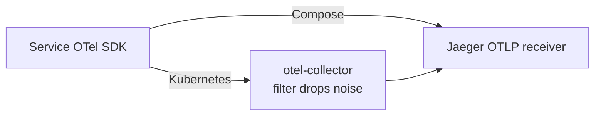

# Design — Observability

Spans come from the OTel SDK in each service, are propagated with `tracecontext`, sampled
at 100%, batched and exported over OTLP. Metrics go to Prometheus/Grafana; logs carry the
trace and span id, which joins all three signals.

The Kubernetes collector is `kubernetes/observability/otel-collector.yaml`.

## Configuration

Shared env (per `architecture.md`): `OTEL_SERVICE_NAME=<service>`,
`OTEL_EXPORTER_OTLP_ENDPOINT` (`http://jaeger:4317` in Compose, the collector in k8s),
`OTEL_EXPORTER_OTLP_PROTOCOL=grpc`, `OTEL_{TRACES,METRICS,LOGS}_EXPORTER=otlp`,
`OTEL_TRACES_SAMPLER=always_on`, `OTEL_PROPAGATORS=tracecontext`,
`OTEL_RESOURCE_ATTRIBUTES=service.namespace=banking-app`.

- Spring Boot: gRPC `:4317`. accounts-service and transactions-service disable built-in
  Spring tracing (`management.tracing.enabled: false`) in favor of the OTel SDK;
  api-gateway currently leaves it enabled (`enabled: true`, probability 1.0).
- Frontend: HTTP/protobuf `:4318`, generating W3C context so the gateway continues the
  trace.
- Java Postgres access uses the OTel JDBC driver (`jdbc:otel:postgresql://...`) so DB
  spans join the trace.
- Metrics: Micrometer → `/actuator/prometheus`.
- Logs: pattern includes `[%X{traceId},%X{spanId}]`.

## Error handling

Observability is best-effort and must not break requests: if Jaeger or the collector is
down the SDK drops on overflow. Misconfigurations: `w3c` propagator → "Unsupported type of
propagator"; gRPC exporter on `:4318` or `http/protobuf` against gRPC → connection errors.

## Verification

1. `docker exec <c> env | grep OTEL` (or `kubectl exec`).
2. Check connectivity to the OTLP endpoint from inside a container.
3. Grep logs for `[a-f0-9]{32},[a-f0-9]{16}`.
4. Exercise a request and confirm one connected trace in Jaeger.
5. Confirm Prometheus targets are up and transaction histograms appear.

Known issue: frontend pod logs may not appear in `kubectl logs` (Next.js edge-runtime
routing of the structured logger); tracing is unaffected (tasks.md task 4).
