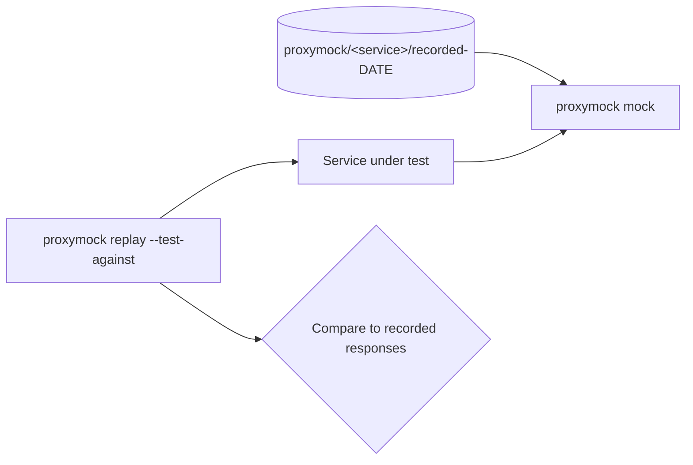

# Design — Service Integration Tests

proxymock both drives the service (replay) and stands in for its dependencies (mock), so
most of a suite is recorded data rather than code, and one mechanism covers HTTP, gRPC,
Postgres, Mongo and Kafka. Record once against a running stack; every run after is
hermetic.

## Execution model (every service)

1. Start `proxymock mock --in <recorded-dir> --service <dep>=<port> ...`.
2. Start the service with outbound calls routed to the mock (`HTTP(S)_PROXY` from
   `make proxymock-env`, or the service's own host/port env vars).
3. `proxymock replay --test-against localhost:<app-port> --in <recorded-dir>`; unmatched
   requests or divergent responses fail the run.
4. `make proxymock-stop` tears down.

Ports and `--service` maps live in each service's `Makefile` (app / inbound / outbound
ports are unique per service); the Makefile is the source of truth. Shared pieces:
`make proxymock-record`, `proxymock-mock`, `proxymock-clean`, `proxymock-stop`.

## Per-service notes

- **transactions-service:** mock postgres, accounts, user, fraud gRPC and the payment
  providers; replay deposit/withdraw/transfer plus fraud-reject and insufficient-funds. A
  thin JPA/Kafka test checks the persisted row and event.
- **api-gateway, accounts-service:** mock their dependencies; gateway recordings include
  `401` cases and a rate-limiter case.
- **user-service:** add a Makefile (extending the existing `proxymock-validation` script); replay register → login → profile, `409` duplicate,
  `401` bad credentials, with identity providers mocked.
- **fraud-service:** replay gRPC `CheckTransaction` approve and deny with risk providers
  mocked.
- **notification-service:** the trigger is a Kafka message, so the suite feeds a recorded
  `transaction-events` message to the consumer, mocks the providers, and a thin Go test
  asserts the fan-out.
- **ai-service:** replay the chat endpoint with the 5 LLM calls mocked, plus a
  one-provider-fails recording.
- **frontend:** mock api-gateway; replay the Next.js API routes or drive Playwright.

The proxymock MCP tools (record, mock, replay, score_replay, response_diff, ...) may help
author recordings, but committed suites run through `make` so they don't need MCP.

## Failure behavior

| Condition | Behavior |
|---|---|
| Recorded dir missing | `make` exits non-zero: "run proxymock-record first" |
| Request with no matching recording, or divergent response | Replay reports it; run fails |
| Dependency not in the `--service` map | Call is unmocked and errors; run fails |
| Stale recordings | `make proxymock-clean`, then re-record |

## Approach

Start from a known-good success recording, confirm green, then add failure paths one at a
time. Keep native assertions thin. In CI, add a path-filtered per-service matrix job
running `make integration-test`.
