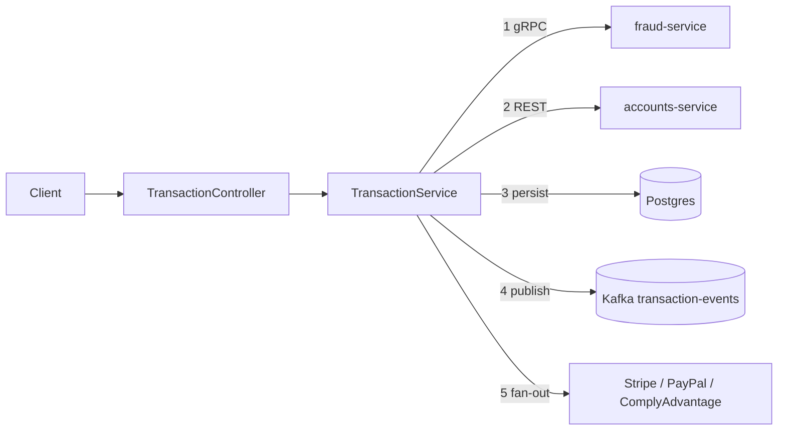

# Design — Transaction Processing

`TransactionService` orchestrates fraud-service (gRPC), accounts-service (REST), its own
Postgres schema, Kafka and the payment providers.

## Sequence (deposit / withdraw / transfer)

1. `FraudServiceClient.checkTransaction` with `pickMerchantCategory()`; reject on
   `approved=false`, fail open on gRPC error.
2. `validateAccountOwnership` via `AccountsServiceClient`.
3. Transfer only: `verifyTransferCompliance` (ComplyAdvantage) throws on matches or
   non-low risk.
4. `withAccountLock` / `withAccountLocks` (sorted ids): read balance, check sufficiency,
   `updateAccountBalance`; roll back the debit if the credit fails. Persist `COMPLETED` +
   `processed_at`, or `FAILED` and rethrow.
5. Record the amount histogram, publish the Kafka event, fan out via
   `CompletableFuture.allOf` (failures logged only).

## Components

- `TransactionController` — endpoints, validation, spans, user id from the security
  context.
- `TransactionService` (`@Transactional`) — orchestration and the `ReentrantLock` map.
- `FraudServiceClient` — net.devh `@GrpcClient` blocking stub, `fraud.v1`
  `FraudChecker.CheckTransaction` (account_id, user_id, amount, transaction_type,
  merchant_category → approved, risk_score, reason); address
  `static://${FRAUD_SERVICE_HOST:banking-fraud}:${FRAUD_SERVICE_PORT:8080}`, plaintext.
- `AccountsServiceClient` — REST to `${ACCOUNTS_SERVICE_URL}`: validate ownership, get and
  update balance, forwarding the inbound auth.
- `PaymentComplianceService` — JDK `HttpClient`, 5s timeouts: Stripe
  `POST /v1/payment_intents`, PayPal `POST /v2/checkout/orders`, ComplyAdvantage
  `POST ${payment.comply.base-url}/searches` (parses `total_matches`, `risk_level`).
- `TransactionEventProducer` — Kafka (`${KAFKA_BROKERS}`), topic
  `${kafka.topic.transactions:transaction-events}`, JSON payload keyed by transaction id.

## Data

`transactions_service.transactions`: `id` IDENTITY PK, `user_id` NOT NULL,
`from_account_id` (null for deposit), `to_account_id` (null for withdrawal), `amount`
positive, `type` (DEPOSIT/WITHDRAWAL/TRANSFER), `description` (500), `status`
(PENDING/COMPLETED/FAILED/CANCELLED), `created_at`, `processed_at`. Flyway owns the
schema; `ddl-auto=validate`.

## Failure behavior

| Dependency | Behavior |
|---|---|
| Fraud service | Fail open |
| Accounts service | Transaction fails, saved `FAILED` |
| Transfer credit | Best-effort debit rollback, saved `FAILED` |
| Kafka, payment fan-out | Logged only |
| Transfer compliance | Blocks the transfer |

## Known limitations (intentional trade-offs)

- Balance updates go over REST outside the local DB transaction: compensation, not
  atomicity.
- The lock is per JVM and does not serialize writes across replicas.
- Demo flags `demo.contract-refactor.enabled` and `demo.memo-bug.enabled` default off,
  stage regressions for the Replay Lab demo, and must never be enabled in production.

## Testing

Unit: fraud reject, fail-open, insufficient balance, same-account transfer, rollback on
credit failure. Integration: happy paths persist the record and emit the event; fraud
reject moves no money. Contract: fraud gRPC shape, accounts REST, Kafka payload. Isolation
via proxymock is covered by the service-integration-tests spec.
